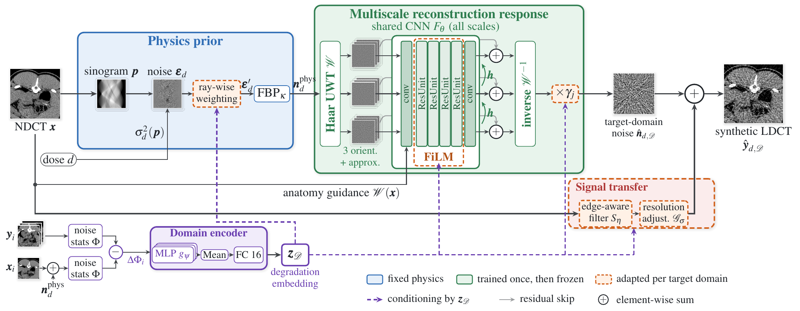

# PhysReCon-LDCT

**Physics-grounded multiscale degradation learning for few-shot adaptive low-dose CT synthesis**

Yousra Taifour — L2TI, Université Sorbonne Paris Nord

[Project page](https://yousranb.github.io/PhysReCon-LDCT/) · Paper (ISBI, under review) · [Architecture (PDF)](figures/PhysReCon_arch_detailed.pdf)



PhysReCon-LDCT synthesizes a low-dose CT (LDCT) image from a normal-dose image (NDCT) and a target dose `d`.
It is a **synthesis** model, not a denoiser:

1. **Physics prior (fixed).** Dose-dependent incremental noise `ε_d ~ N(0, σ²_d(p))` is drawn on the NDCT sinogram, re-weighted ray-wise (RSW) and reconstructed by FBP. Only the noise is reconstructed, which gives `n_phys`. The acquisition parameters (`I0`, `σ_e²`, `κ`) are calibrated once on piglet FBP data.
2. **Multiscale reconstruction response (learned).** An undecimated Haar wavelet transform splits `n_phys` into 3 scales × 3 orientations plus the approximation. One CNN `F_θ` (conv → 4 FiLM-modulated residual units → conv, weights shared across scales, dilation `2^j`) processes the scales coarse to fine. It is guided by the NDCT subbands and adds a residual correction to every band. Per-band gains `γ_j` (5-level decomposition) then rescale the corrected noise.
3. **Signal transfer.** An edge-aware filter `S_η` is followed by a Gaussian resolution adjustment `G_σ`.
4. **Degradation embedding.** For `k` paired target-domain support slices, the difference of noise statistics `ΔΦ_i = Φ(y_i) − Φ(x_i + n_phys)` is pooled by a permutation-invariant encoder (MLP → mean → FC 16) into `z_D ∈ R^16`. `(z_D, log d)` conditions the RSW, FiLM, band gains and signal transfer.

Every loss term compares statistics of the synthetic image with **real** LDCT (tissue-wise NPS, multiscale covariance, texture SWD, signal transfer). No pixel loss is computed between independent noise realizations.

| | Parameters |
|---|---|
| PhysReCon-LDCT (whole model, all doses) | 0.23 M |
| updated when adapting to a new domain | 28 k + `z_D` |
| CycleGAN / CUT / cVAE (one model per dose) | 28.3 M / 14.7 M / 8.1 M |

## Main results (Norsvin IR, 282 test slices per dose, one evaluation for all methods)

Errors, lower is better. NPS_e: NPS magnitude error, NPS_s: NPS shape error, σ_e: noise-level error, HU: absolute HU bias, LP: LPIPS.

| Method | 10 % NPS_e | NPS_s | σ_e | HU | LP | 25 % NPS_e | NPS_s | σ_e | HU | LP |
|---|---|---|---|---|---|---|---|---|---|---|
| *Trained on Norsvin* | | | | | | | | | | |
| CycleGAN | .539 | .276 | .110 | 3.76 | .175 | .274 | .133 | .081 | 2.50 | .120 |
| CUT | .575 | .287 | .150 | 3.62 | .170 | .192 | .095 | .058 | 2.24 | **.112** |
| cVAE | 4.18 | .182 | 1.21 | 9.80 | .300 | 11.0 | .110 | 2.15 | 3.76 | .330 |
| PhysHVS-LDCT | **.195** | **.033** | .150 | 4.87 | .231 | .153 | .080 | .135 | 3.61 | .223 |
| PhysReCon (scratch) | .198 | .096 | **.048** | **2.30** | **.154** | **.126** | **.061** | **.053** | **1.61** | .115 |
| *Trained on piglet, applied to Norsvin* | | | | | | | | | | |
| CUT, zero-shot | .610 | .284 | .152 | 4.24 | **.168** | .164 | .081 | **.049** | 1.70 | **.112** |
| PhysHVS-LDCT, zero-shot | .622 | .291 | .145 | 44.7 | .375 | .329 | .164 | .174 | 46.4 | .368 |
| PhysReCon, zero-shot | 7.72 | .325 | 1.29 | 4.45 | .235 | 3.78 | .208 | .540 | **1.67** | .183 |
| PhysReCon, few-shot adapted | **.251** | **.088** | **.140** | **3.78** | .174 | **.110** | **.043** | .070 | 1.89 | .142 |

Best per block in bold. The project page also has the few-shot adaptation curves on a held-out reconstruction (piglet ASIR40), the ablation and qualitative comparisons.

## Repository

```
physrecon/              the model package
  physics.py            fan-beam projector, dose-dependent noise, FBP, RSW basis (Module A, fixed)
  wavelet.py            undecimated Haar transform with exact inverse
  model.py              ResponseCNN (F_θ), NoiseGain (γ_j), ProjectionResponse (RSW),
                        SignalTransfer (S_η), SignalBlur (G_σ), Embedder (z_D), PhysReCon
  losses.py             statistical losses against real LDCT
  stats.py, data.py     descriptors Φ, tissue classes, support sets
pr_calibrate.py         stage 0: calibrate I0, σ_e², κ on piglet FBP + acceptance test
pr_train.py             stage 1: source training
pr_adapt.py             stage 2: adaptation to a target domain + synthesis of the test set
pr_eval.py, evaluate.py evaluation (NPS, noise, HU, LPIPS, DISTS, distributional and signal metrics)
pr_collect.py, pr_abl_collect.py   few-shot and ablation tables
datasets.py             aligned NDCT/LDCT volumes, subject-wise / slab-wise splits
prepare_data.py         piglet DICOM tree -> HU volumes
prepare_nifti.py        multi-subject NIfTI (Norsvin) -> HU volumes
register.py, check_alignment.py, find_dose.py, pr_dicom_check.py   data checks
baselines:
  models.py, train.py, run_benchmark.py   CycleGAN, CUT, conditional VAE (one model per dose)
  cadm.py, train_cadm.py, priors.py, diffusion_common.py, calibrate_noise.py   PhysHVS-LDCT
  cross_apply.py         apply a piglet-trained baseline to another dataset (zero-shot)
  zeng_baseline.py       image-domain Zeng-style simulation
scripts/                 experiment scripts (run them from the repository root)
  reproduce_table1.sh    scratch PhysReCon on Norsvin, zero-shot PhysHVS, unified evaluation
  run_ablation_rsw_film.sh   controlled ablation, 3 seeds
  pr_fewshot.sh          few-shot sweep (piglet ASIR40 / MBIR, Norsvin)
docs/                    project page (GitHub Pages)
figures/                 architecture and qualitative figures
```

## Installation

```bash
git clone https://github.com/yousranb/PhysReCon-LDCT.git
cd PhysReCon-LDCT
python -m venv .venv && source .venv/bin/activate    # or a conda environment
pip install -r requirements.txt
```

The diffusers / peft / transformers packages are only needed for the PhysHVS-LDCT baseline.
A single GPU is enough. On an NVIDIA A100, source training takes about 1 h and an adaptation run about 7 min (synthesis of the test set included).

## Data

The CT data are **not distributed** with this repository. The code expects aligned volumes in HU, produced by the two preparation scripts:

```bash
# piglet: one subject, several doses and reconstructions (FBP, ASIR20/40/60, MBIR)
python prepare_data.py --root /path/to/piglet_sorted --out data/piglet
# Norsvin: several pigs, one folder per subject (NIfTI)
python prepare_nifti.py --root /path/to/norsvin --inspect
python prepare_nifti.py --root /path/to/norsvin --out data/norsvin --series normal=100 low=25 ultralow=10 --recon IR
```

**Split.** Three folds; fold 0 is the test set.
- **Norsvin:** the split is by subject, so a pig is never in both train and test.
- **Piglet:** a contiguous test slab, with 5 slices removed on each side of it.

Support slices for adaptation always come from the training part. Evaluation uses every 8th body slice of the test set.

## Usage

```bash
# 0) calibrate the acquisition physics on piglet FBP
python -u pr_calibrate.py --data data/piglet --recon FBP --doses 5 10 25 --out pr_calib

# 1) source training (piglet) -> pr_runs/physrecon_stvar/final.pt
#    the exact arguments of every run are saved in pr_runs/<run>/args.json
python -u pr_train.py --data data/piglet --physics pr_calib/physics.json --recons FBP ASIR20 ASIR60 \
    --doses 5 10 25 --st_varmap --iters 6000 --out pr_runs --tag stvar
#    add --proj_resp --sig_blur to train RSW and G_sigma from the start; a checkpoint trained without
#    them still loads in pr_adapt.py, the missing modules start at identity and are learned during adaptation

# 2a) few-shot: embedding only, k support units of the target domain
python -u pr_adapt.py --ckpt pr_runs/physrecon_stvar/final.pt --data data/norsvin --recon IR --doses 25 10 \
    --k 3 --mode z --runs runs_norsvin --name physrecon_z_k3

# 2b) adaptation of the ≈28k domain parameters + z_D, early stopping on a held-out support subject
python -u pr_adapt.py --ckpt pr_runs/physrecon_stvar/final.pt --data data/norsvin --recon IR --doses 25 10 \
    --k 99 --mode zfilm --steps 600 --exclude_subjects ER01035833 --test_stride 8 \
    --runs runs_norsvin --name physrecon_zfilm

# 3) evaluation, on the same test slices as every other method
python -u evaluate.py --runs runs_norsvin/physrecon_zfilm_100_IR_to_10_IR_f0_s0 --out results_norsvin \
    --baselines identity --unit_range -150 250
```

Adaptation modes (`--mode`):

| Mode | What it does |
|---|---|
| `zero` | no target data |
| `z` | embedding only, no gradient |
| `zref` | embedding refined by gradient |
| `zfilm` | embedding + domain parameters (last FiLM layer, RSW, band gains, signal transfer) |
| `heads` | domain parameters without FiLM |
| `full` / `scratch` | fine-tuning / training from scratch on the support set |

**Hyperparameters.**
- **Loss weights:** λ_cov = λ_SWD = λ_0 = 1 and λ_ST = 0.5. They are fixed and were not tuned.
- **Source training:** Adam, learning rate 2·10⁻⁴, cosine decay, 6000 iterations, batch of four 256×256 crops.
- **Adaptation:** Adam, learning rate 10⁻³, at most 600 steps.

## Reproducing the paper

```bash
sh scripts/run_ablation_rsw_film.sh      # ablation, 3 seeds, then: python pr_abl_collect.py
sh scripts/pr_fewshot.sh piglet ASIR40   # few-shot curves on the held-out reconstruction
sh scripts/reproduce_table1.sh           # scratch / zero-shot rows + unified evaluation -> table1.csv
```

The baselines are trained with `train.py` (one model per dose, 20 000 iterations, 128×128 patches) and with `train_cadm.py` for PhysHVS-LDCT.

## Citation

```bibtex
@inproceedings{taifour2026physrecon,
  title     = {PhysReCon-LDCT: Physics-Grounded Multiscale Degradation Learning for Few-Shot Adaptive Low-Dose CT Synthesis},
  author    = {Taifour, Yousra and others},
  booktitle = {IEEE International Symposium on Biomedical Imaging (ISBI)},
  year      = {2026},
  note      = {under review}
}
```

## License

To be added before the repository is made public.

## Acknowledgements

Experiments were carried out on the Grid'5000 testbed, supported by a scientific interest group hosted by Inria and including CNRS, RENATER and several universities as well as other organizations (see https://www.grid5000.fr).
